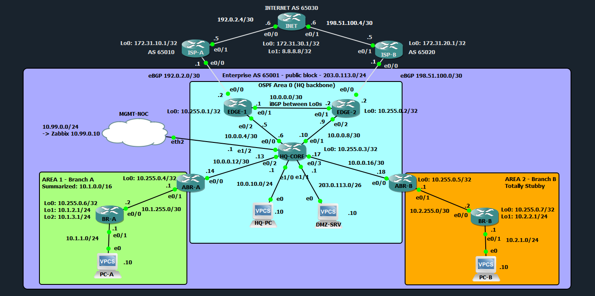

# Enterprise OSPF + BGP Network with NOC Monitoring (GNS3 Lab)

A head office and two branches connected to two Internet providers, built and tested in GNS3: multi-area OSPF inside, eBGP/iBGP at the edge with routing policy, NAT on both edge routers, and a Zabbix monitoring stack that detects failures through SNMP polling, SNMP traps and syslog. Every failover was tested and measured, and the problems found along the way are documented.

**Author:** Chester Evio · CCNA
**Tools:** GNS3 · Cisco IOU L3 15.0(1) · Zabbix 7.0 LTS · Ubuntu Server 24.04 · VirtualBox



## At a glance

| Area | What is implemented |
|---|---|
| OSPF | 3 areas: backbone, Branch A summarized to one /16, Branch B **totally stubby**. Point-to-point links, manual router IDs, passive LAN interfaces |
| BGP | eBGP to two ISPs, iBGP between the edge routers (loopback peering, `next-hop-self`) |
| Routing policy | Outbound via ISP-A (**local preference 200**), inbound via ISP-A (**AS-path prepend** toward ISP-B), **no-transit** prefix filter, Null0 anchor for the public /24 |
| Failover | Default route follows BGP (no `always`), BGP timers tuned from 180 s to 15 s hold time |
| NAT | PAT on each edge with its own public address; DMZ uses public addresses without NAT |
| Monitoring | Zabbix on a dedicated management network: SNMP polling, custom BGP session items and triggers, SNMP traps, central syslog, NTP |

## Devices

| Role | Device | Qty |
|---|---|---|
| Edge routers (BGP + NAT) | EDGE-1, EDGE-2 | 2 |
| Core router (Area 0) | HQ-CORE | 1 |
| Area border routers | ABR-A, ABR-B | 2 |
| Branch routers | BR-A, BR-B | 2 |
| Simulated providers | ISP-A, ISP-B, INET (8.8.8.8 test target) | 3 |
| Hosts | HQ-PC, DMZ-SRV, PC-A, PC-B (VPCS) | 4 |
| Monitoring server | Zabbix VM (Ubuntu, VirtualBox), joined through a GNS3 Cloud | 1 |

## Addressing

| Element | Value |
|---|---|
| Enterprise AS / public block | AS 65001 · 203.0.113.0/24 |
| ISPs / Internet | ISP-A AS 65010 (primary) · ISP-B AS 65020 (backup) · INET AS 65030 |
| Router IDs (Loopback0) | 10.255.0.1 – .7 (EDGE-1, EDGE-2, HQ-CORE, ABR-A, ABR-B, BR-A, BR-B) |
| Backbone links | 10.0.0.0/30 – 10.0.0.16/30 |
| HQ users / DMZ | 10.0.10.0/24 · 203.0.113.0/26 |
| Branch A (Area 1) | 10.1.0.0/16 (summary): 10.1.1.0/24 LAN, 10.1.2.0/24 and 10.1.3.0/24 loopbacks |
| Branch B (Area 2) | 10.2.1.0/24 LAN, 10.2.2.0/24 loopback |
| NAT addresses | EDGE-1 → 203.0.113.65 · EDGE-2 → 203.0.113.129 |
| ISP links | 192.0.2.0/30 (ISP-A) · 198.51.100.0/30 (ISP-B) |
| Management network | 10.99.0.0/24 – HQ-CORE 10.99.0.1, Zabbix 10.99.0.10 |

Public addressing uses the RFC 5737 documentation ranges; AS numbers are private (RFC 6996).

## How it was built

The lab was built in phases, each verified before the next. Screenshots per phase are in [verification/](verification/).

| Phase | Content | Key result |
|---|---|---|
| 1 | Addressing, OSPF Area 0 | Loopback-to-loopback reachability across the backbone |
| 2 | Areas 1 and 2, LSA types | Type 1 LSAs stay inside their area; ABRs inject type 3 |
| 3 | Summarization, totally stubby area | EDGE-1: 22 → 19 routes. BR-B: 16 type-3 LSAs → **1** (a default route) |
| 4 | eBGP to both ISPs | Public /24 advertised via a Null0 anchor, default route into OSPF |
| 5 | iBGP, `next-hop-self` | ISP-B's routes reached through EDGE-2 instead of out via ISP-A |
| 6 | Routing policy, BGP timers | Both directions on ISP-A by policy; transit leak closed; failover 210 s → ~10 s |
| 7 | NAT on both edges | All internal hosts reach the Internet; failover and recovery measured |
| 8 | Zabbix monitoring | Failures detected by trap, syslog and polling, and compared |
| 9 | Failover test plan | Six scenarios, including a dead router and loss of both ISPs |

## Routing design

**OSPF.** HQ is Area 0. Branch A (Area 1) is summarized at ABR-A to a single 10.1.0.0/16; a Null0 discard route on ABR-A drops traffic for unused addresses inside the summary. Branch B (Area 2) has one exit, so it is **totally stubby**: BR-B's routing table holds only its own networks and one default route.

**BGP.** Each edge peers with its own ISP using the directly connected address (TTL 1, immediate failure detection). The edges peer with each other over loopbacks with `next-hop-self`, so routes learned from one ISP are usable by the other edge.

**Policy.**

| Goal | Tool | Where |
|---|---|---|
| Outbound traffic prefers ISP-A | `set local-preference 200` on routes from ISP-A | EDGE-1, inbound |
| Inbound traffic prefers ISP-A | `set as-path prepend 65001 65001 65001` | EDGE-2, outbound to ISP-B |
| Never act as a transit network | prefix-list permitting only 203.0.113.0/24 | Both edges, outbound |

Before the prepend, the Internet chose ISP-B for inbound traffic purely because of the "oldest path" tie-breaker. Before the filter, each edge advertised the other ISP's routes, offering our network as a path between the two providers.

**Default route.** Each edge advertises a default into OSPF only while it has one from its ISP (`default-information originate` without `always`). When both ISPs are down there is no default anywhere, so traffic fails immediately instead of looping between the edges.

More detail: [docs/design-decisions.md](docs/design-decisions.md)

## Monitoring design

```
Routers (source Loopback0) ── SNMP poll  (UDP 161) ──┐
                           ── SNMP traps (UDP 162) ──┼─► Zabbix VM 10.99.0.10 ─► dashboard, problems, graphs
                           ── syslog     (UDP 514) ──┘      (rsyslog, snmptrapd, chrony NTP)
```

- **Management network** 10.99.0.0/24 on HQ-CORE, bridged from GNS3 to a VirtualBox host-only network. Only the 7 company routers are monitored; the ISPs belong to other organizations.
- **SNMPv2c** read-only, restricted by ACL to the Zabbix server. Community stored once as a secret Zabbix macro.
- **Custom BGP monitoring:** one SNMP item per BGP session (BGP4-MIB peer state), value map for the states, trigger "not established" – ISP sessions High, iBGP Average.
- **Traps:** custom template [Lab SNMP traps](configs/zabbix-templates/Lab_SNMP_traps.yaml) for link and BGP traps. Interfaces shut on purpose ("administratively down") are ignored.
- **Syslog:** one file per router plus a combined file; Zabbix raises a problem on BGP neighbor-down messages.
- **NTP:** the Zabbix VM serves time to all routers, so logs, traps and graphs share one clock.

## Test results

| # | Scenario | Result |
|---|---|---|
| 1 | Baseline | Outbound and inbound both via ISP-A |
| 2 | ISP-A link fails | Traffic moves to ISP-B. **~210 s** outage with default BGP timers (ISP-A could not see the link go down and waited for the 180 s hold timer) → **~10 s** after tuning timers to 5/15 |
| 3 | ISP-A link restored | Traffic returns to ISP-A by policy. Without NAT: no loss. With NAT: ~26 s loss (see [troubleshooting](docs/troubleshooting.md)) |
| 4 | EDGE-1 powered off | ~40 s outage, set by the OSPF dead timer; Zabbix: router unavailable + iBGP session down |
| 5 | HQ-CORE ↔ EDGE-1 link down | Traffic still exits via ISP-A through EDGE-2 → EDGE-1 |
| 6 | Both ISPs down | No default route anywhere; Internet traffic fails immediately, internal traffic unaffected |

**Detection of the same failure (ISP-A link shut):**

| Method | Problem raised |
|---|---|
| SNMP trap | 13:45:46 |
| Syslog | 13:45:47 |
| SNMP polling (30 s interval) | 13:46:01 |

Push methods report within a second; polling can take up to its interval. Polling stays the reliable source – a lost trap or log message is corrected by the next poll, and a dead router cannot send a trap.

## Troubleshooting highlights

| Symptom | Root cause | Fix |
|---|---|---|
| iBGP routes valid but routed out via the other ISP | iBGP keeps the eBGP next hop; it resolved through the default route (seen with `show ip cef`) | `next-hop-self` |
| Failover took 3.5 minutes | ISP-A could not detect our link going down; BGP waited 180 s | BGP timers 5/15 (BFD in production) |
| Inbound path changed after unrelated events | Equal AS paths decided by the "oldest path" tie-breaker | AS-path prepend toward the backup ISP |
| Zabbix server not running | `DBPassword` line still commented in the config | Uncommented, verified with `grep ^DBPassword` |
| Routers never synchronized NTP | The VM's time client cannot serve time to others | Replaced with chrony + `allow` |
| Traps not written | snmptrapd runs as `Debian-snmp`, not root | Folder ownership |
| False "link down" alarms after every reboot | Routers send linkDown traps for unused, admin-down ports at boot | Trigger ignores "administratively down" |

Full write-up (16 issues): [docs/troubleshooting.md](docs/troubleshooting.md)

## Known limitations and next steps

- **SNMPv2c** sends the community in clear text. Next step: SNMPv3 (authPriv).
- **No device hardening** (SSH, AAA, enable secret) – out of scope here; covered in my [School Campus Network](https://github.com/cge-net/school-network-project) project.
- **NAT state lives on one router**, so connections reset on failover. Production would use a stateful firewall pair.
- **Failure detection uses BGP and OSPF timers.** Production would use BFD for sub-second detection.
- **In-band management:** monitoring traffic shares the production network. An out-of-band network would keep monitoring available during outages.
- **Syslog and traps over UDP** can be lost – boot messages sent before OSPF converged were lost in testing.
- The ISPs send a default route unconditionally; an upstream failure behind an ISP would not be detected (IP SLA tracking would).

## Repository layout

```
configs/routers/            Running configuration of all 10 routers
configs/zabbix-vm/          Netplan, rsyslog, snmptrapd, chrony and Zabbix server settings
configs/zabbix-templates/   Lab SNMP traps template (YAML, importable into Zabbix 7.0)
docs/                       Design decisions and troubleshooting log
topology/                   Topology diagram
verification/               Screenshots per phase, each folder with its own README
```

## Notes

- Secrets are replaced with placeholders (`<SNMP_COMMUNITY>`, `<DB_PASSWORD>`).
- Cisco IOU images are not included. The configurations can be rebuilt on IOU, IOL (Cisco Modeling Labs) or IOSv.
